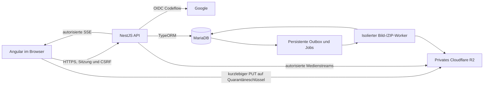

# Architekturrahmen

Status: Entwurf für die spätere Umsetzung, 16. November 2026. Verbindliche Einzelregeln stehen in [REQ-047 bis REQ-052](../requirements/README.md). Keine Anwendung wurde in dieser Phase erstellt.

## Systemgrenzen

Ein modularer Monolith mit getrennt ausführbarem Worker hält den Anfang beherrschbar. Kein Redis-Zwang im vorgegebenen Stack: Jobs, Outbox, Leases, Sessions und verteilte Limits können zunächst über MariaDB abgewickelt werden. Bei nachgewiesenem Engpass wird eine zusätzliche Infrastruktur als Architekturentscheidung bewertet. R2-Zugriff erfolgt über S3-kompatiblen Adapter, Metadaten ausschließlich über TypeORM.

Frontend und API sollten unter derselben Origin liegen, zum Beispiel / und /api/v1. Das vereinfacht sichere Cookies und CSRF. Produktionsdomain, Hosting und Reverse Proxy sind noch offen. Externe Google-Redirects werden exakt registriert. Der Browser bekommt keine Google-/R2-Backendsecrets.

## Daten- und Zugriffsmodell

User besitzt Alben. Album enthält Photos, Photo besitzt unveränderliche PhotoVersions und Derivatives. Jeder Datensatz mit Albumbezug ist auf den erlaubten Eigentümer-/Freigabekontext einzuschränken. Datenbank-FKs und serverseitige Invarianten sichern zusätzlich, dass referenzierte Versionen tatsächlich zum angegebenen Foto/Album gehören.

ShareGrant hat entweder persönlichen Empfänger oder Tokenhash, Fähigkeiten, Ablauf, Widerruf und Version. Für Gäste existiert eine freigabegebundene GuestIdentity; Feedback gehört zu User oder GuestIdentity und einer Foto-Version, soweit versionsbezogen. Persönliche Einladungen binden nach Annahme an Googles iss + sub; eine geänderte E-Mail allein überträgt keinen Zugriff.

Freigabefähigkeiten:

| Akteur | Betrachten | Originale/ZIP | Feedback | Upload/Verwalten | Freigaben |
| --- | --- | --- | --- | --- | --- |
| Eigentümer | Ja | Ja | Ja | Ja | Ja |
| Persönlicher Empfänger | Expliziter Grant | Separates Recht | Separates Recht | Nein | Nein |
| Gast | Gültiger Link und ggf. Passwort | Separates Recht | Separates Recht | Nein | Nein |
| Fremder Nutzer | Nein | Nein | Nein | Nein | Nein |

Mehrere Grants werden nicht blind vereinigt: Jeder Request verwendet einen klaren Zugriffskontext, damit Wasserzeichen, versteckte Bilder und Ablauf einer Freigabe nicht durch zufällige Fähigkeitskombinationen umgangen werden. Eigentümerzugriff bleibt ein eigener Kontext.

## Sicherer Upload

1. API prüft Eigentum, Formatankündigung, Limit und Quote; Upload und Reservierung werden gespeichert.
2. Browser lädt auf einen zufälligen Quarantäneschlüssel. Presigned PUT ist kurz gültig und trotzdem wiederverwendbar bis zum Ablauf. Signierte Content-Type-Angaben ersetzen keine Inhaltsprüfung oder verlässlich erzwungene Größenlimits.
3. API prüft Objektgröße/Integrität; Worker erstellt einen serverseitigen unveränderlichen Verarbeitungssnapshot unter einem Schlüssel, den keine ausgegebene Upload-URL beschreiben kann. Genau dessen Bytes werden gescannt und dekodiert.
4. Worker erzeugt neue sichere Derivate. Erst nach vollständiger Prüfung werden Snapshot und Derivate als aktive Version veröffentlicht. Nachträgliches Beschreiben des ursprünglichen Quarantäneschlüssels verändert kein veröffentlichtes Foto.
5. Datenbankstatus und Outbox sind transaktional; R2-Aufrufe liegen außerhalb der DB-Transaktion und werden durch Wiederholung/Abgleich konsistent gehalten. Bei Fehlern bleibt der Zustand gesperrt.

Verwaiste oder nachträglich neu hochgeladene Quarantänedateien werden zeitgesteuert entfernt; Kosten- und Bandbreitenlimits schützen auch diesen Zeitraum. Worker führen keine unbekannten Programme aus Uploads aus und holen keine externen Ressourcen nach.

## Lesen, Widerruf und Cache

Medien werden im MVP über einen autorisierenden Endpunkt gestreamt. Das ermöglicht Rechteprüfung bei jeder neuen Anfrage sowie Abbruch laufender Streams. Private Inhalte erhalten no-store, werden nicht von Service Workern oder einem öffentlichen CDN gespeichert. Bereits sichtbare oder heruntergeladene Dateien sind technisch nicht rückholbar.

Direkte signierte Lese-URLs wären eine spätere bewusste Optimierung mit einem bis zu deren Ablauf bestehenden Widerrufsfenster. Sie erfüllen die hier festgelegte Widerrufsanforderung ohne zusätzliche Autorisierungsschicht nicht. R2-Presigned-URLs werden daher im MVP nur für begrenzte Quarantäneuploads verwendet.

## API und Entwicklung

REST deckt Login/Sitzung, Album-CRUD, Foto-Listen, Upload-Initialisierung/Abschluss/Abbruch, Grants, Feedback und ZIP-Jobs ab. SSE transportiert Ereignisse, keine Vollobjekte aus anderen Alben. OpenAPI beschreibt JSON- und Dateiantworten, CSRF und Fehler; SSE-Schemas werden ergänzend dokumentiert. DTOs bilden niemals blind alle Entity-Felder ab.

Vorgeschlagene Repoaufteilung: apps/web, apps/api, apps/worker, packages/api-client und docs. Tests nutzen echte MariaDB, kontrollierten OIDC-Provider und lokalen Storage; ein zusätzlicher R2-Contractlauf prüft Anbieterbesonderheiten. Test-Login ist in Produktionskonfiguration nicht startbar.
